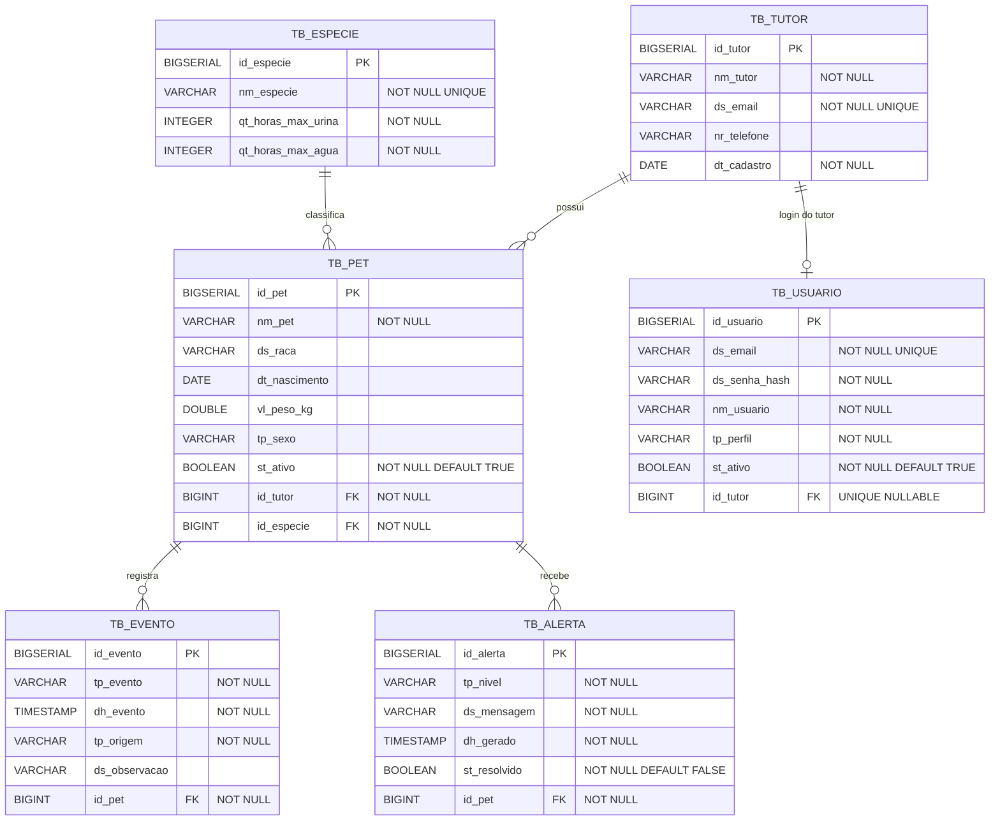

# Diagrama Entidade–Relacionamento (DER)

> Modelo físico do PostgreSQL do projeto SOLIN, conforme as migrations Flyway V1–V7.

## Coerência com o Diagrama de Classes

Cada entidade JPA do diagrama de classes mapeia diretamente para uma tabela aqui:

| Classe (JPA) | Tabela | PK |
|---|---|---|
| `Tutor` | `TB_TUTOR` | `id_tutor` |
| `Especie` | `TB_ESPECIE` | `id_especie` |
| `Pet` | `TB_PET` | `id_pet` |
| `Evento` | `TB_EVENTO` | `id_evento` |
| `Alerta` | `TB_ALERTA` | `id_alerta` |
| `Usuario` | `TB_USUARIO` | `id_usuario` |

Os enums (`TipoEvento`, `NivelAlerta`, `OrigemEvento`, `Sexo`, `Perfil`) são persistidos como `VARCHAR` pelo Hibernate via `@Enumerated(EnumType.STRING)` — opção escolhida ao invés de `ORDINAL` porque manter a string facilita a leitura direta no banco e evita problemas se a ordem dos valores do enum mudar no futuro.

## Índices

| Índice | Tabela | Colunas | Motivo |
|---|---|---|---|
| `IX_EVENTO_PET_DH` | `TB_EVENTO` | `(id_pet, dh_evento)` | Acelera a query `findUltimoEventoPorTipo` usada pelas Strategies de alerta |

## Cascateamento

O fluxo disponível para pets usa **soft delete** (`ST_ATIVO = false`): preserva eventos e alertas para histórico. As FKs mantêm os vínculos de domínio; exclusões físicas em cascata não são o fluxo de remoção de pets da interface.
